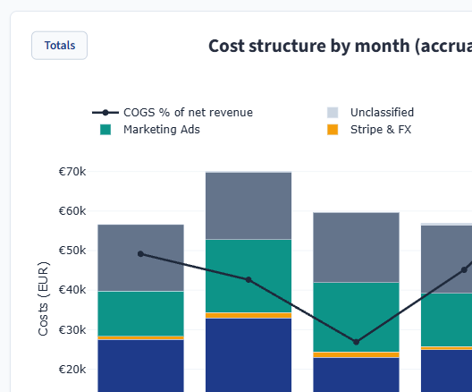
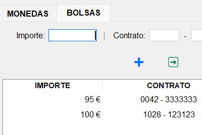
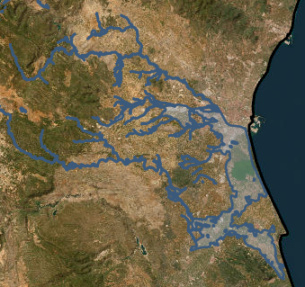

<!--
  PLANTILLA PARA AÑADIR UN NUEVO PROYECTO (copiar dentro de .portfolio-list):

  ::: {.portfolio-card}
  ::: {.portfolio-thumb-wrap}
  {.portfolio-thumb}
  :::
  ::: {.portfolio-body}
  ### [Título del Proyecto](carpeta-proyecto/index.qmd) [GitHub](https://github.com/marbul33/repo){.portfolio-gh-link}

  Descripción del proyecto (si supera 3 líneas o tiene varios párrafos/listas,
  el botón "Ver más" aparece automáticamente).
  :::
  :::
-->

::: {.portfolio-list}

::: {.portfolio-card}
::: {.portfolio-thumb-wrap}
{.portfolio-thumb}
:::
::: {.portfolio-body}
### [Multi-Currency Treasury Reconciliation & P&L](treasury-pnl/index.qmd) [GitHub](https://github.com/marbul33/treasury-pnl-reconciliation){.portfolio-gh-link}

Este motor multidivisa de conciliación de tesorería y cuenta de resultados (P&L) automatiza el cierre mensual, sustituyendo el seguimiento manual en Excel, propenso a errores. Fue diseñado para resolver un cuello de botella operativo recurrente en pymes internacionales y negocios de *e-commerce* que operan con Stripe, neobancos multidivisa (Revolut/Wise) y sistemas de facturación ERP. Centraliza la conciliación en dos niveles entre EUR, USD y GBP, separando los márgenes operativos sin IVA de la autonomía de caja real (*cash runway*). Además, detecta fugas silenciosas de liquidez como facturas duplicadas, transferencias vencidas o liquidaciones incompletas con trazabilidad al céntimo. Aquí puedes explorar el dashboard ejecutivo interactivo, desarrollado a partir de un caso práctico auditable de 6 meses.
:::
:::

::: {.portfolio-card}
::: {.portfolio-thumb-wrap}
{.portfolio-thumb}
:::
::: {.portfolio-body}
### [Abaco (Versión Simplificada)](abaco/index.qmd) [GitHub](https://github.com/marbul33/abaco){.portfolio-gh-link}

Abaco es un software de gestión de efectivo que ahorra **5 horas** semanales en comparación con el control manual en papel o Excel. Se desarrolló tras identificar ineficiencias operativas en el día a día durante mi etapa como responsable operativo de oficina en Banco Sabadell. Centraliza todas las operaciones relacionadas con el recuento e inventario de monedas y bolsas de monedas, y mejora además la trazabilidad. Aquí puedes explorar una versión simplificada desarrollada en HTML.
:::
:::

::: {.portfolio-card}
::: {.portfolio-thumb-wrap}
{.portfolio-thumb}
:::
::: {.portfolio-body}
### [Risk Map: Comunidad Valenciana](patricova/index.qmd) [GitHub](https://github.com/marbul33/trabajo_BigData){.portfolio-gh-link}

Este mapa de riesgos interactivo, desarrollado en R, fue uno de mis primeros proyectos. Cartografía las zonas inundadas durante la DANA de 2024, junto con otros riesgos de inundación. Visita el repositorio para consultar todos los detalles del proyecto.
:::
:::

:::
