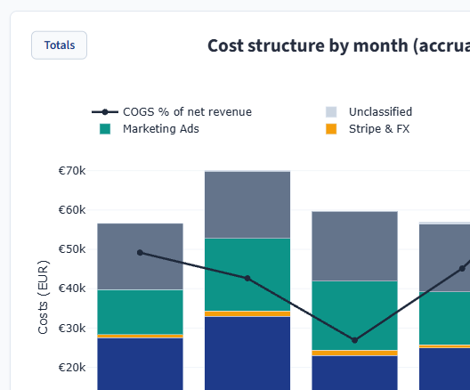
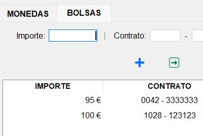
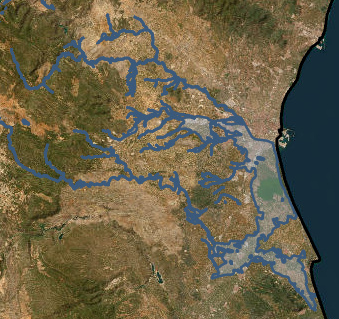

::: {.portfolio-list}

::: {.portfolio-card}
::: {.portfolio-thumb-wrap}
{.portfolio-thumb}
:::

::: {.portfolio-body}

### [Multi-Currency Treasury Reconciliation & P&L](treasury-pnl/index.qmd) [<i class="bi bi-github"></i> GitHub <i class="bi bi-box-arrow-up-right"></i>](https://github.com/marbul33/treasury-pnl-reconciliation){.portfolio-gh-link aria-label="GitHub repository"}

This Multi-Currency Treasury Reconciliation & P&L engine automates month-end closing, replacing error-prone manual tracking in Excel. It was built to solve a recurring operational bottleneck in international SMEs and e-commerce businesses operating across Stripe, multi-currency neo-banks (Revolut/Wise), and ERP invoicing. It centralizes two-layer reconciliation across EUR, USD, and GBP, separating ex-VAT operating margins from actual cash runway. It also flags silent cash leaks such as duplicate invoices, overdue wires, or payout shortfalls with cent-exact traceability. Here, you can explore the interactive executive dashboard built on a 6-month auditable case study.

:::
:::

::: {.portfolio-card}
::: {.portfolio-thumb-wrap}
{.portfolio-thumb}
:::

::: {.portfolio-body}
### [Abaco](abaco/index.qmd) [<i class="bi bi-github"></i> GitHub <i class="bi bi-box-arrow-up-right"></i>](https://github.com/marbul33/abaco){.portfolio-gh-link aria-label="GitHub repository"}

Abaco is a cash management software that saves **5 hours** per week compared to manual tracking on paper or Excel. It was developed after identifying day-to-day operational inefficiencies during my time as a Branch Operations Manager at Banco Sabadell. It centralizes all operations related to coin & coin bag counting and inventory. It also enhances traceability. Here, you can explore a simplified version built in HTML.
:::
:::

::: {.portfolio-card}
::: {.portfolio-thumb-wrap}
{.portfolio-thumb}
:::

::: {.portfolio-body}
### [Risk Map: Valencian Community](patricova/index.qmd) [<i class="bi bi-github"></i> GitHub <i class="bi bi-box-arrow-up-right"></i>](https://github.com/marbul33/trabajo_BigData){.portfolio-gh-link aria-label="GitHub repository"}

This interactive risk map, built with R, was one of my first projects. It maps the areas flooded during the 2024 DANA storm, along with other flood risks. Visit the repository to explore the full details.

:::
:::

:::
